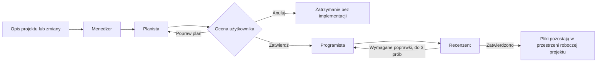

# CodeFabric

CodeFabric to ukończony, indywidualny prototyp portfolio do generowania projektów programistycznych z pomocą AI. Użytkownik opisuje nową aplikację lub zmianę. CodeFabric przygotowuje plan, czeka na jego zatwierdzenie albo korektę, generuje lub edytuje pliki i wykonuje przegląd z użyciem modelu językowego, porównując rezultat z zatwierdzonym planem.

Aplikacja używa modeli [Ollamy](https://ollama.com/) uruchomionych lokalnie lub na prywatnym serwerze. Nie łączy się z OpenAI Codex i nie korzysta z niego jako dostawcy modeli.

Projekt powstał podczas 150-godzinnych praktyk programistycznych w Urzędzie Komisji Nadzoru Finansowego w Warszawie, od 3 listopada do 3 grudnia 2025 r. Po praktykach był rozwijany samodzielnie.

> **Status projektu z praktyk:** CodeFabric jest indywidualnym projektem z praktyk, a nie oficjalnym produktem ani systemem produkcyjnym Urzędu Komisji Nadzoru Finansowego.

<a id="what-the-prototype-demonstrates"></a>

## Co pokazuje prototyp

- Interfejs Streamlit do opisywania nowej aplikacji lub zmiany w istniejącym projekcie.
- Role planisty, programisty, recenzenta i menedżera koordynowane przez LangGraph.
- Zatwierdzanie przez użytkownika przed implementacją: akceptacja planu, prośba o zmiany albo anulowanie bez modyfikacji plików projektu.
- Generowanie plików i celowane edycje z wykorzystaniem modeli Ollamy wybranych w interfejsie.
- Przegląd plików tekstowych przez model językowy względem zatwierdzonego planu, z najwyżej trzema próbami korekty.
- Oddzielne, trwałe przestrzenie robocze i zapisywanie historii rozmowy dla każdego projektu.
- Podgląd plików, kopie zapasowe, przywracanie i eksport ZIP.

Interfejs aplikacji jest po polsku. Wygenerowany kod nie jest automatycznie wykonywany — przed użyciem człowiek musi go przejrzeć, uruchomić i przetestować. Przegląd przez model jest sprawdzeniem spójności, nie gwarancją poprawności ani zamiennikiem testów wykonywanych przez człowieka.

<a id="workflow"></a>

## Przebieg pracy



| Element | Odpowiedzialność |
| --- | --- |
| `app.py` | Interfejs Streamlit, sesje projektów, zatwierdzanie i narzędzia do plików |
| `graph/workflow.py` | Węzły LangGraph i kierowanie przebiegiem pracy |
| `agents/planner.py` | Przygotowanie planu implementacji na poziomie plików |
| `agents/coder.py` | Tworzenie i edycja obsługiwanych plików tekstowych po zatwierdzeniu |
| `agents/reviewer.py` | Porównywanie wygenerowanych plików z planem przy użyciu modelu |
| `agents/manager.py` | Deterministyczne sterowanie przebiegiem i limitem poprawek |
| `tools/llm_factory.py` | Konfiguracja dostępu do lokalnych lub prywatnych instancji Ollamy |
| `tools/chat_store.py` | Zapis historii, przestrzeni roboczych, kopii zapasowych i eksport ZIP |

<a id="technologies"></a>

## Technologie

- Python
- Streamlit
- LangGraph
- LangChain Core i LangChain Ollama
- Ollama
- pytest
- Ruff
- GitHub Actions

<a id="requirements"></a>

## Wymagania

- Python 3.10 lub nowszy.
- [Zainstalowana Ollama](https://ollama.com/download) na tym samym komputerze lub dostępnym prywatnym serwerze.
- Co najmniej jeden model Ollamy dostępny dla aplikacji.

Większe modele mogą wymagać znacznej ilości RAM lub VRAM. Domyślna konfiguracja używa `qwen2.5-coder:7b`, ale interfejs obsługuje także inne modele zgłaszane przez skonfigurowaną instancję Ollamy.

<a id="setup"></a>

## Uruchomienie

<a id="1-start-ollama-and-download-a-model"></a>

### 1. Uruchom Ollamę i pobierz model

Zainstaluj i uruchom Ollamę, a następnie pobierz domyślny model:

```bash
ollama pull qwen2.5-coder:7b
```

Na macOS Ollamę można także zainstalować i uruchomić przez Homebrew:

```bash
brew install ollama
brew services start ollama
ollama pull qwen2.5-coder:7b
```

<a id="2-run-codefabric-on-macos-or-linux"></a>

### 2. Uruchom CodeFabric na macOS lub Linux

```bash
git clone https://github.com/JakubLewosz/CodeFabric.git
cd CodeFabric
python3 -m venv .venv
source .venv/bin/activate
python -m pip install --upgrade pip
python -m pip install -r requirements.txt
cp .env.example .env
python -m streamlit run app.py
```

<a id="3-run-codefabric-on-windows-powershell"></a>

### 3. Uruchom CodeFabric w Windows PowerShell

```powershell
git clone https://github.com/JakubLewosz/CodeFabric.git
cd CodeFabric
py -3 -m venv .venv
.venv\Scripts\Activate.ps1
python -m pip install --upgrade pip
python -m pip install -r requirements.txt
Copy-Item .env.example .env
python -m streamlit run app.py
```

Alternatywnie w Windows uruchom `run.bat`. Skrypt sprawdza wersję Pythona, tworzy `.venv`, instaluje zależności i uruchamia aplikację.

Po uruchomieniu otwórz <http://localhost:8501>.

<a id="configuration"></a>

## Konfiguracja

CodeFabric odczytuje ustawienia z `.env`. Skopiuj `.env.example` i zmień tylko wartości wymagane przez Twoją instancję Ollamy:

```dotenv
OLLAMA_BASE_URL=http://localhost:11434
OLLAMA_TOKEN=
VERIFY_SSL=true
CODEFABRIC_DATA_DIR=./chats
CODEFABRIC_MODELS=qwen2.5-coder:7b
MODEL_CODER=qwen2.5-coder:7b
OLLAMA_TIMEOUT=120
```

| Zmienna | Znaczenie |
| --- | --- |
| `OLLAMA_BASE_URL` | Adres lokalnego lub prywatnego serwera Ollamy |
| `OLLAMA_TOKEN` | Opcjonalny token bearer; nie zapisuj go w kontroli wersji |
| `VERIFY_SSL` | Weryfikacja certyfikatu TLS; wyłączenie przewidziano tylko dla zaufanego serwera z certyfikatem samopodpisanym |
| `CODEFABRIC_DATA_DIR` | Lokalny katalog historii, przestrzeni roboczych i kopii zapasowych |
| `CODEFABRIC_MODELS` | Zapasowa lista modeli, gdy serwer jej nie zwróci |
| `MODEL_CODER` | Model używany wyłącznie przez skrypt diagnostyczny |
| `OLLAMA_TIMEOUT` | Limit czasu żądania używany przez agentów i skrypt diagnostyczny |

Domyślny katalog `./chats` jest ignorowany przez Git. Po wybraniu innej ścieżki wewnątrz repozytorium dodaj ją do `.gitignore` albo przechowuj dane poza repozytorium.

Aby sprawdzić połączenie z Ollamą niezależnie od Streamlit, uruchom:

```bash
python debug_raw.py
```

Diagnostyka wysyła rzeczywiste żądanie do modelu. Zwykłe testy repozytorium nie wymagają działającej instancji Ollamy.

<a id="verification-and-quality-tooling"></a>

## Weryfikacja i narzędzia jakości

Zainstaluj zależności deweloperskie i uruchom sprawdzenia:

```bash
python -m pip install -r requirements-dev.txt
bash scripts/check.sh
```

Skrypt kompiluje moduły Pythona, sprawdza formatowanie i reguły Ruff oraz uruchamia pytest. GitHub Actions wykonuje ten sam skrypt na Pythonie 3.10 i 3.12 w Ubuntu oraz na Pythonie 3.12 w Windows. Sprawdzenia dotyczą samego CodeFabric — nie uruchamiają ani nie testują w pełni aplikacji przez niego wygenerowanych.

<a id="data-handling-and-boundaries"></a>

## Dane i granice działania

- `.env`, zapisane rozmowy, kopie zapasowe i wygenerowane pliki projektów są wyłączone z kontroli wersji przez konfigurację repozytorium.
- Opcjonalny token jest wysyłany tylko do skonfigurowanego serwera Ollamy.
- CodeFabric zapisuje obsługiwane pliki tekstowe wewnątrz wybranej przestrzeni roboczej projektu.
- Nie instaluje automatycznie wygenerowanych zależności ani nie uruchamia wygenerowanych aplikacji.
- Przed uruchomieniem sprawdź wygenerowany kod i zależności.

<a id="prototype-limitations"></a>

## Ograniczenia prototypu

- Jakość wyniku zależy od wybranego modelu, jego okna kontekstowego i jasności polecenia.
- Większe projekty mogą przekroczyć ograniczony kontekst przekazywany do modelu.
- Recenzent wykonuje przegląd z pomocą modelu językowego; nie dowodzi poprawności, bezpieczeństwa ani gotowości produkcyjnej wygenerowanego programu.
- CodeFabric nie jest usługą wieloużytkownikową ani odizolowanym środowiskiem wykonywania niezaufanego kodu.
- To ukończony prototyp portfolio, obecnie bez aktywnego rozwoju.

<a id="development-process"></a>

## Sposób tworzenia projektu

CodeFabric powstawał przy wsparciu AI: OpenAI Codex pomagał w planowaniu, implementacji, debugowaniu i przeglądzie. Autor odpowiadał za określanie wymagań, sprawdzanie zmian, uruchamianie aplikacji, testowanie jej zachowania i poprawianie błędów. Codex był narzędziem pracy; działająca aplikacja CodeFabric korzysta z Ollamy.
